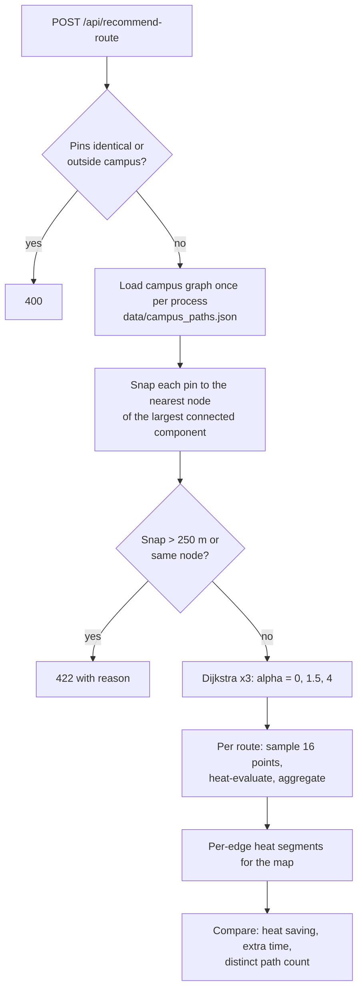

# Route Calculation and Optimization

How `POST /api/recommend-route` turns two campus pins into Fastest, Balanced and Coolest walking routes. Source: `backend/app/services/route_service.py`.

Routing runs **in-process** over a committed copy of the campus path network. There is no external routing service, so routes are fast (well under a second), work offline, and can never detour onto public roads outside campus.

## 1. High-Level Flow



## 2. The Campus Path Graph

- **Source:** OpenStreetMap `highway=*` ways inside the campus bounding box (+~100 m), downloaded once by `backend/scripts/build_campus_graph.py` through the Overpass API and committed as `backend/data/campus_paths.json` (~45 KB).
- **Excluded:** `motorway`, `trunk`, `primary` (and their `_link`s). This removes the GST highway (NH32) on the campus's western edge, which is not part of any campus walk.
- **Built at runtime:** an undirected adjacency list; edge length = haversine distance between consecutive way nodes. Each edge keeps its way name (or `footpath`/`path`/`steps`/`campus road`) for directions.
- **Largest component only:** OSM maps some campus service lanes as disconnected islands. Pins snap only onto the largest connected component so every snapped pair is routable.
- **Node heat:** each node takes the `heat_risk` of the nearest seeded heat point (`heat_data` table).
- **Refresh:** re-run the script when campus paths change in OSM. The graph and node heat are built once per process, so restart the API after re-seeding heat data.

## 3. Cost Function

Each edge costs

```
length_m * (1 + alpha * mean_heat_risk_of_its_two_nodes / 100)
```

| Route | alpha | Meaning |
|---|---|---|
| Fastest | 0 | Pure shortest walk |
| Balanced | 1.5 | A hot edge counts up to 2.5x its length |
| Coolest | 4 | A hot edge counts up to 5x its length |

Dijkstra (stdlib `heapq`) runs once per profile. Walking time = distance / 80 m per min (~4.8 km/h).

## 4. Per-Route Analysis

`analyze_route_heat` (shared with `/api/route-heat`):

1. Sample up to 16 evenly spaced points along the geometry.
2. Evaluate heat risk at each via `heat_service.evaluate_coordinate_heat_risk` (nearest seeded point within 1.5 km, else interpolated features through the ML model).
3. Aggregate: average and maximum heat risk, risk level (Low / Moderate / High / Extreme at 25/50/75), mean shade score as `shaded_area_percentage`, and a 0-100% `heat_profile`.

Each route also returns:

- `heat_segments`: one entry per graph edge, `{coords: [[lat, lon], [lat, lon]], heat_risk}`. The frontend draws the chosen route coloured edge by edge from these.
- `turn_by_turn`: consecutive edges on the same way are merged into one step ("Head along X", "Continue onto Y", with metres), ending with "Arrive at your destination".
- `final_score`: `0.5 * heat/100 + 0.25 * dist/max_dist + 0.25 * time/max_time`, kept for comparison.

## 5. Comparison and Recommendation

- `heat_reduction_points` = fastest average heat minus coolest average heat (floored at 0).
- `extra_time_minutes` = coolest duration minus fastest duration.
- `mapped_route_count` = number of **distinct** node paths among the three; `alternatives_available` is true when it is above 1.
- `recommended_route` is `coolest_route` when it actually saves heat, otherwise `fastest_route`.
- `summary` states the trade-off plainly, or says that every mapped path has similar exposure.

## 6. Honest Limitations

- **Sparse map data.** OSM has ~170 campus ways, mostly roads. Many campus trips have only one sensible path, so the three options often coincide. The UI then shows a single route and says so instead of inventing alternatives.
- **Smooth heat field.** The seeded heat grid varies gently across campus, so heat-weighting changes the route only when a meaningfully cooler corridor exists. With a real sensor or satellite-derived heat layer the same cost function would produce larger differences.
- **Static heat for routing.** Route heat uses the seeded dataset, not live weather. Live weather affects every location equally on a campus this size, so it would not change which path is coolest.

## 7. Worked Example

Biotechnology Block (12.8225, 80.0405) to Dr. T.P. Ganesan Auditorium (12.8240, 80.0460), verified against the committed graph:

| Route | Distance | Avg heat |
|---|---|---|
| Fastest | 0.74 km | 54.8 |
| Balanced | 0.75 km | 50.2 |
| Coolest | 0.75 km | 50.2 |

Two distinct paths; the coolest lowers average exposure by 4.6 points at no extra time.

## 8. `/api/route-heat`

Ad-hoc heat analysis for any `[lat, lon]` path inside campus. Runs the same `analyze_route_heat` sampling and aggregation as above, with distance and duration reported as 0 because no routing is involved.
